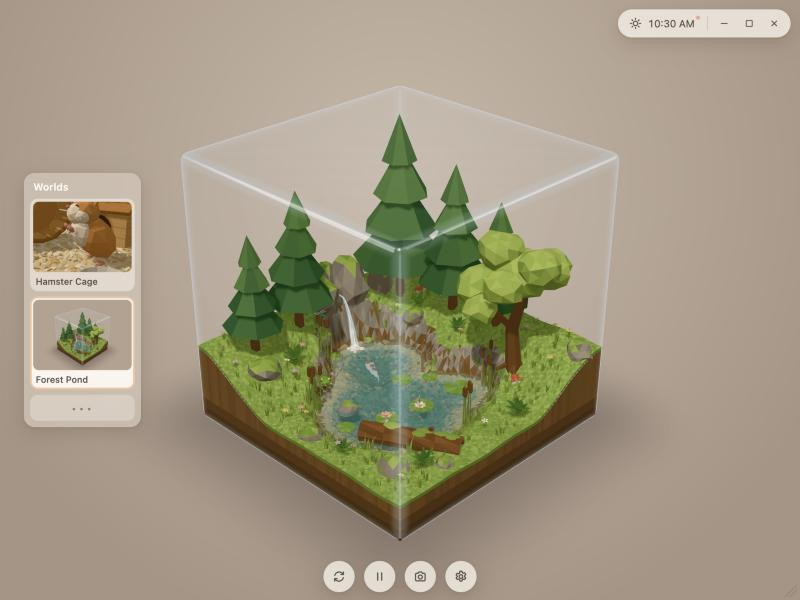
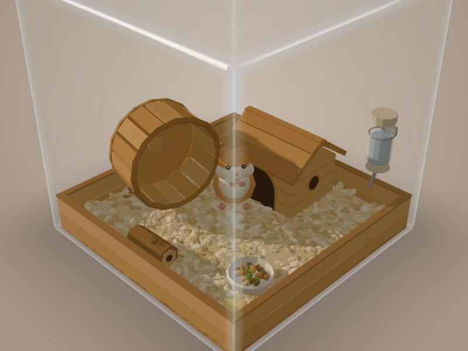
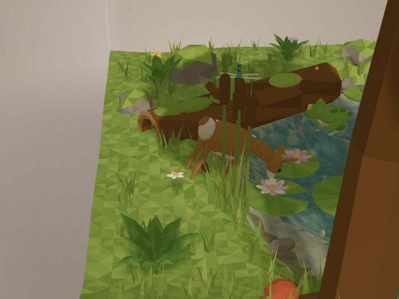
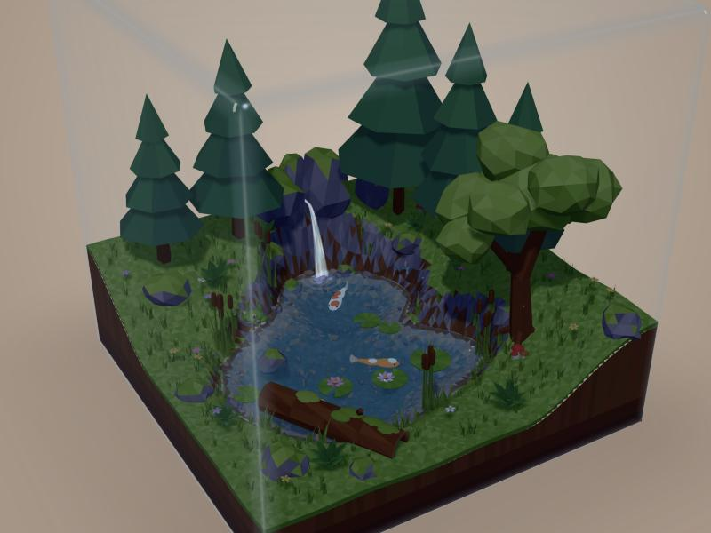
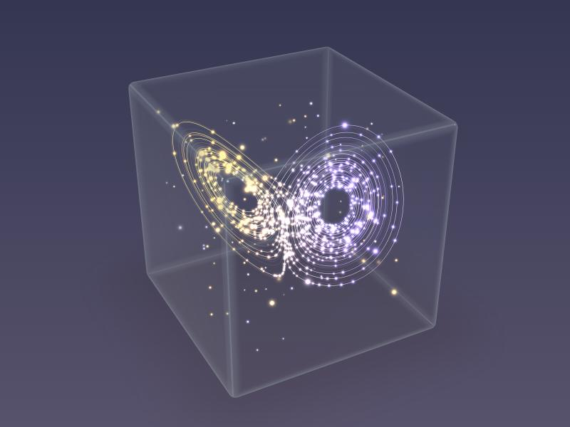
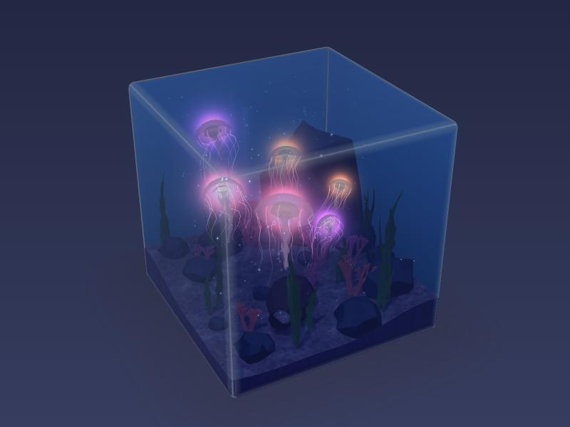
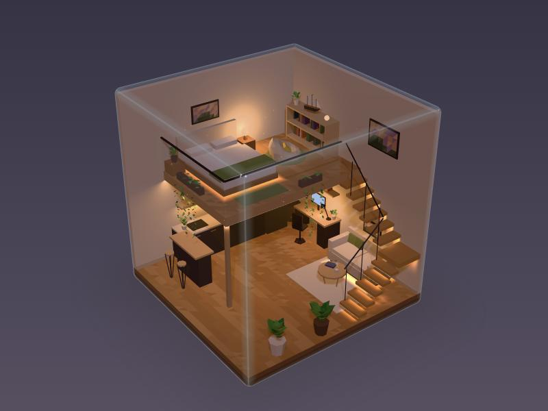

# Wonderarium

A small glass cube sits on your desktop, and inside it a tiny world goes about its business. Part terrarium, part aquarium, part cabinet of small wonders: hence the name. Nothing in it needs you. A hamster runs its wheel at midnight and sleeps off the afternoon; a spring spills from a cleft in the rocks into a pond where koi drift under the lily pads. You can lean in and play, or leave it in a corner of the screen and glance at it now and then, the way you might at a window.

**[Try it in your browser](https://charlesxu-jingyue.github.io/wonderarium/)**, where it lives in a tab, or run the desktop version on a Mac (below), where it floats on your desktop as it was meant to.



The cube is only ever a boundary. It has no base or furniture of its own: whatever a world holds is inside the glass, and anything that grows past it (a tall pine, a wide rock) is simply cut off there, like a diorama. The design notes in [docs/DESIGN.md](docs/DESIGN.md) tell the longer story of how each world was made.

## Five worlds, so far

**The hamster cage.** A wooden tray of shavings with a deep wheel, a plank cottage with an arched door and a round window, a water bottle, a food bowl, a chew log and a block of cheese. The hamster lives by a handful of needs that rise over time, so it eats, drinks, grooms, digs, wanders and runs when it feels like it, and it leans nocturnal: sleepy in the afternoon, keen on the wheel after dark. When it goes to bed it walks in through the door and disappears behind the wall, and at night the cottage windows glow.



- **Feed it.** Click the bedding and a cheerio drops there. It fetches it, sits up on its hind legs and nibbles it from its paws, or tucks it into a cheek if it is full.
- **Pet it.** Rest the pointer on it: it turns to you, eyes half closed, and hearts drift up.
- **Pick it up.** Drag it to lift it and set it down somewhere else. A quick click is a boop.
- **Knock.** Tap the cottage. It rocks a little, and a sleeping hamster wakes and comes out, still drowsy, for a few minutes.
- **Rearrange.** Drag the furniture around. A move that would block the door, the wheel, the bottle or the bowl is politely refused.
- **Tap the glass.** Click empty glass and it stands up to look at you.

**The forest pond.** A slab of earth with a pond sunk into it: a faceted surface that breathes, clears over the shallows and rings wherever something touches it. Pines and a leafy tree stand along a ridge, and ferns, grass and cattails lean in one unhurried breeze. Three koi wander, rest and come up to kiss the surface. A frog sits for a long time (which is most of what frogs do), croaks more after dark, and moves house now and then by a hop or a lazy swim. A dragonfly hovers and darts. Water lilies fold shut toward evening, leaves let go of the big tree, and fireflies come out at dusk.

Now and then a small spotted fawn steps in through the glass. It might go down to the water to drink, nibble the grass, lie down for a while or just look around before it wanders out again. No two visits run the same way, and it comes most often around dawn and dusk.



- **Feed the koi.** Click the water and a pinch of food scatters on the surface.
- **Shake a tree.** Click one and it sways; the leafy one lets a few leaves go.
- **Say hello.** Rest the pointer on the frog or the fawn and it turns to look at you; click the frog and it croaks, or decides it is time to move.
- **Tap the glass.** Click anywhere else: the koi scatter, the frog dives, the dragonfly darts off and the fawn bounds away.



**The Lorenz attractor.** The abstract one, with no floor and nothing alive, only light in empty space. Edward Lorenz wrote down three small equations in 1963 as a sketch of air rolling over a warm surface, and found that two starting points a hair apart soon go entirely different ways, which is how chaos got its butterfly. Here hundreds of sparks follow those equations, each trailing a short comet's tail, amber on one wing and violet on the other and whiter where the wings cross. Beneath them a few faint threads of one long path sketch the shape they are all drawn into, and loose motes drift and twinkle in the space around it. It moves slowly, and glows a little brighter at night.



- **Gather a cloud.** Click near the sparks and three dozen of them leave wherever they were and gather, in cyan, onto the one you picked, close enough to look like a single bright spark. For a while they travel as one; then, somewhere between a few seconds and half a minute depending on where they started, they fray into a streak and scatter over both wings, keeping their colour until they are fully mixed back in. It is sensitive dependence on initial conditions, slowed down enough to watch.

**The jellyfish tank.** An underwater fantasy, more about mood than marine biology. Deep blue water fills the tank right up to the lid, over pale lavender sand, with a great slate boulder towering in the back corner and smaller rocks around it, branching coral in pink, peach and lilac, ribbons of weed leaning in a slow current, and an old pot lying on its side. Light falls in soft shafts from the surface and throws a wandering net of caustics over the sand, bubbles rise now and then from the pot, and specks drift down through the blue. Six jellies, large and small, beat their way through it in slow pulses (a quick squeeze and a long, easy relaxing) and coast and sink between beats, each drifting toward a depth of its own choosing that changes every half minute or so. Their tentacles and frilled arms have a little weight: they stream behind on the way up and sink slowly to hang beneath whenever nothing pulls them. By day the tank is a deep, calm blue; at night it turns a dark, inky blue, the sand and rocks sink into dim shapes, and the jellies glow pink, violet and peach from within.



- **Rouse one.** Click a jelly and it glows a little brighter and beats its way upward for a few quick pulses before settling back into its own pace.
- **Make bubbles.** Click the sand and a string of bubbles rises from the spot.

**The loft.** A home, warm and lived in: a double-height room with a bedroom on a mezzanine, after a reference whose light is mostly hidden. Floating stairs turn in the back corner, rising beside the glass to a landing and then climbing the back wall to the mezzanine, and the sofa tucks in beneath them, with a round table on a rug before it. Under the mezzanine, a dark kitchen runs along the other wall, the fridge at its back end and a wooden bar with two stools reaching into the room, and a desk with a monitor stands against the back wall. Upstairs, a low bed, a big beige bean bag with a yellow pillow, turned toward a low, deep bookshelf with a model ship on top, a globe lamp, and pothos trailing over the glass railing. By day the sun falls in through the open top. As evening comes the loft's own lights come on, one by one: strips hidden under each stair tread, the mezzanine's edge, the sofa, the bed and the kitchen shelf, so that mostly what you see is the glow they throw on the wall and floor; then a desk lamp and the monitor, and later the lamp by the bed. Someone works late at the desk, shuts it down before midnight and reads in bed a while longer. Steam curls from a mug on the table and dust drifts in the lamplight.



- **Switch a light.** Click a lamp, the monitor, the stairs, the sofa, the bed, the kitchen shelf or the edge of the mezzanine to switch its light. It stays that way until its own hours next change.

## The box itself

**Time follows yours.** The box keeps your local time, and one sun and moon serve every world: warm and low at dawn and dusk, soft lavender at night, never quite dark. Click the clock to shift it, speed it up (up to 600 times) to watch a day go by, or sync it back to real time. The light belongs to the room, not the cube, so as you turn the cube the shadows sweep across what is inside it.

**Controls only when you want them.** The window has no frame and a transparent background, so the cube seems to float on your desktop. Move the pointer over it and the controls fade in:

- the **Worlds** panel on the left, with a still picture of each world, taken the first time you open it;
- a pill at the top right with the clock and the minimise, fullscreen and close buttons;
- round tools along the bottom: reset the view, pause, take a screenshot, and settings (keep the window on top, drift slowly when idle, open the screenshots folder);
- a corner at the bottom right to resize.

Drag any bare part of the controls (the pill, the panel, the space between the tools) to move the window. Drag anywhere on the cube to turn it and scroll to zoom. Left alone for a while, it drifts slowly round on its own. In fullscreen, and in the web version, the box sits on a backdrop in its world's own colours (warm wood for the hamster, green shade for the pond, deep slate for the attractor, ocean blue for the tank, warm taupe for the loft), and the backdrop follows the sky from day to night.

**Everything is remembered.** Which world you were looking at, where the furniture stands, how the hamster was feeling, where the lily pads drifted and the clock settings all carry over to next time.

## Running it on a Mac

You need macOS, Git and Node 24. If you have them already, skip to step 3.

1. **Git.** Open Terminal and run the command below. If Git is missing, macOS offers to install the Command Line Tools, which include it; if it is already there, the command just says so.

   ```bash
   xcode-select --install
   ```

2. **Node 24.** The project asks for Node 24 exactly (the version is in `.nvmrc`). The simplest way to get it is [nvm](https://github.com/nvm-sh/nvm): install nvm by following its README, open a new Terminal window, and then you are ready for the next step, where `nvm install` reads the version from the project. If you would rather use Homebrew, `brew install node@24` works too, as long as `node --version` then prints a 24.

3. **Get the code and install.**

   ```bash
   git clone https://github.com/CharlesXu-Jingyue/wonderarium.git
   ```

   ```bash
   cd wonderarium
   ```

   ```bash
   nvm install
   ```

   ```bash
   npm ci
   ```

   `nvm install` fetches and switches to Node 24 (skip it if you used Homebrew). `npm ci` installs exactly the versions in the lockfile, into the project's own `node_modules`.

   If you have SSH keys set up with GitHub, `git clone git@github.com:CharlesXu-Jingyue/wonderarium.git` works as well.

4. **Open the box.**

   ```bash
   npm start
   ```

   This builds the app and opens the window. The very first launch also downloads Electron, the runtime the window runs on (about 100 MB, once), so give it a minute. After that it opens in a few seconds.

To close it, use the × in the pill at the top right, or press ⌘Q. To open it again later, go back to the folder and run `npm start`; in a new Terminal window, run `nvm use` first so the right Node is picked.

**If something goes wrong.** An error mentioning an unsupported engine means the wrong Node is active: run `nvm use` in the project folder and try again. If the first launch was interrupted while Electron was downloading, delete the half-finished copy and launch again, which fetches it afresh:

```bash
rm -rf node_modules/electron && npm ci && npm start
```

**Where your box keeps its things.** Saves, window position and screenshots live in `~/Library/Application Support/Wonderarium`. Delete that folder to start over from scratch. To keep them somewhere else, copy `.env.example` to `.env.local` and set `BITS_DATA_DIR` to a folder of your choosing.

## Working on it

```bash
npm run dev
```

This is the development loop. Vite rebuilds into `dist/renderer` whenever a file changes and the window reloads itself; changes under `electron/` need a restart. There is no dev server, so nothing listens on a port. `npm run typecheck` checks the TypeScript, and `npm run preview` serves the built page to an ordinary browser, where it falls back to `localStorage` and a stand-in wallpaper so you can judge the look without the desktop behind it.

The web version is the same page, built and published to GitHub Pages by `.github/workflows/pages.yml` on every push to `main`. In a browser tab it saves to the browser's own storage, offers screenshots as downloads, uses the browser's fullscreen, and quietly hides the controls that only make sense for a desktop window.

The code is small and plainly laid out:

- `electron/` is the main process: the window, a private `app://` file scheme, and the save file. The page never touches Node; it talks to the main process only through a small bridge.
- `src/shell/` draws the cube, the light, the clock and the controls.
- `src/worlds/` holds one folder per world, plus a few things they share: a low-poly kit, soft glowing dots and lines, and a grid for finding paths around obstacles.

Each world gets its own group inside the cube, a read-only view of the clock and the light, and the pointer, and nothing else. Adding one is a new folder and a line in `src/worlds/index.ts`.

Two longer notes live in `docs/`: [DESIGN.md](docs/DESIGN.md), on how each world was made, and [WINDOWS.md](docs/WINDOWS.md), a plan for bringing the box to Windows.

## How the project keeps to itself

The guiding rule is that this project should be able to vanish without a trace. Delete the folder (and the app-data folder, if you like) and nothing else on the machine remembers it was here, so every tool that would normally scatter files around your home directory has been asked, politely, to stay indoors.

Every dependency, Electron included, lives in the project's own `node_modules`, with exact versions recorded in the lockfile. npm would ordinarily keep its download cache in `~/.npm`, but `.npmrc` sends it to `.cache/npm` instead. Electron keeps its downloaded runtime in `~/Library/Caches/electron` unless told otherwise; set the cache before the first launch to keep that in the project too:

```bash
export electron_config_cache="$PWD/.cache/electron"
```

The app does its part as well: Chromium's own caches, logs and crash reports follow the data folder rather than settling in `~/Library`.

Development with Claude Code runs inside the operating system's sandbox, configured in `.claude/settings.json`. Shell commands can write only inside this folder and the app-data folder, and can reach only the npm registry and GitHub; network git commands step outside it only through an explicit permission prompt, and machine-specific paths sit in the untracked `.claude/settings.local.json`. Inside the sandbox, Electron's downloader ignores the network proxy unless told to use it, so the runtime is fetched explicitly:

```bash
ELECTRON_GET_USE_PROXY=1 GLOBAL_AGENT_HTTPS_PROXY="$HTTPS_PROXY" node node_modules/electron/install.js
```

The window itself cannot open from inside the sandbox, which refuses the system services a native window needs, so `npm start` and `npm run dev` are run either by you or by Claude with an explicit, per-command exception.

## Licence

Wonderarium is released under the [MIT licence](LICENSE): use it, change it and share it as you like, keeping the copyright notice.
